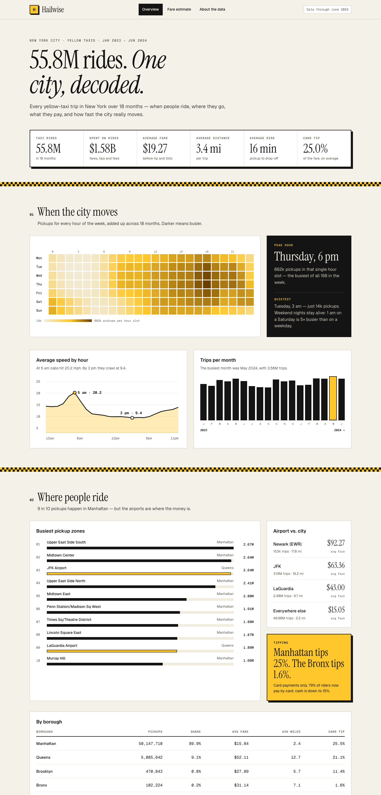
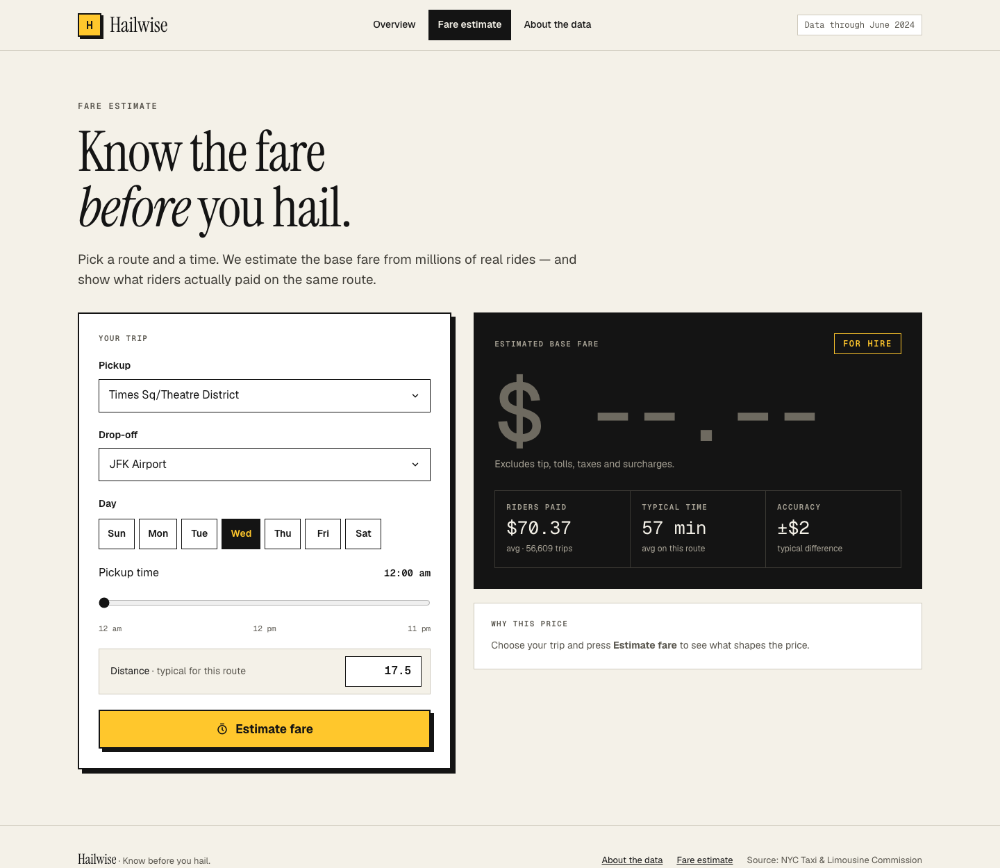
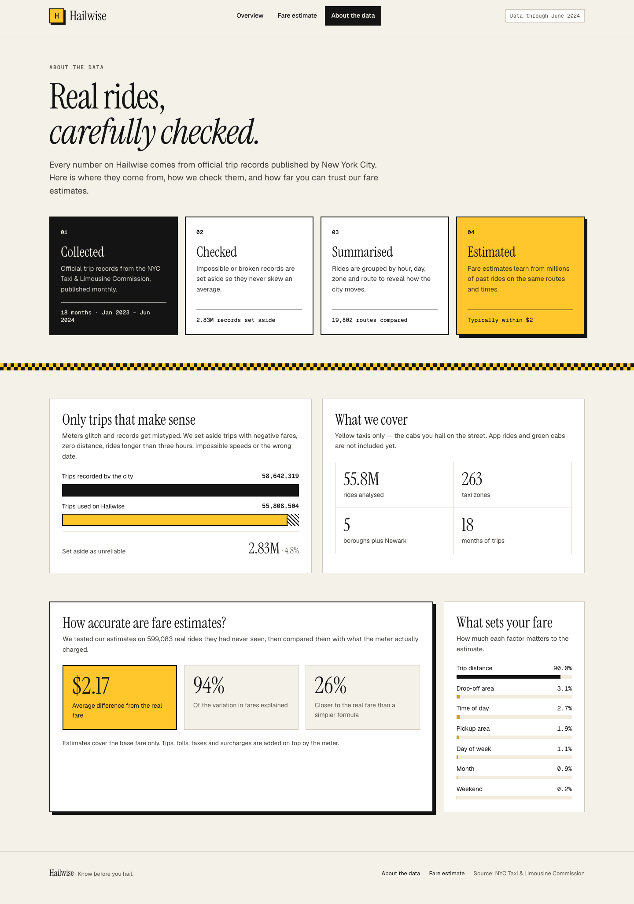

# Hailwise — know before you hail

**Hailwise** is a New York taxi insights website with a live fare estimator. Behind it is an end-to-end
**big data pipeline** that processes **58.6 million real NYC taxi trips** with **Apache Spark**, finds
patterns in how the city moves, and predicts fares with **machine learning** (Spark MLlib).



<p align="center">
  
  
</p>

> **In one sentence for non-technical people:** *"I took every yellow-taxi ride in New York over
> 18 months (about 58 million rides), cleaned it, found when and where people travel and how much
> they pay, and built a tool that estimates your fare before you get in."*

---

## Results (full run on a MacBook Air, 16 GB RAM)
| Metric | Value |
|---|---|
| Raw records | **58,642,319** (Jan 2023 - Jun 2024, 0.94 GB compressed) |
| Invalid records removed | 2,833,815 (4.83%) |
| Clean records analysed | **55,808,504** |
| Full pipeline time (download excluded) | ~3 minutes; ~7 minutes including download |
| Total fares in the data | $1.58 billion |
| Average trip | $19.27 fare, 3.4 miles, 16 minutes, 25% card tip |
| Partition pruning | 1 month (3.4M rows) in 0.1 s vs all 55.8M rows in 0.4 s |

**Fare prediction (tested on 599,083 unseen trips):**
| Model | MAE (avg. error) | RMSE | R² |
|---|---|---|---|
| Linear Regression (baseline) | $2.92 | $4.77 | 0.914 |
| **Gradient-Boosted Trees** | **$2.17** | **$3.90** | **0.943** |

Trip distance drives 90% of the prediction, followed by drop-off zone and pickup hour.

**Key findings:** weekday 6-7 pm is the busiest time of the week; taxis average 20 mph at 5 am
but under 10 mph in the afternoon; JFK trips follow the $70 flat fare.

## What it shows
| Question | Answer from the data |
|---|---|
| When is NYC busiest? | Day × hour heatmap, monthly trend |
| Where do people take taxis? | Top pickup zones, boroughs, most popular routes |
| How fast is traffic? | Average speed for every hour of the day |
| How do people pay and tip? | Card vs cash, tip % by hour, airport vs city fares |
| What will my ride cost? | ML fare predictor (Gradient-Boosted Trees) |

## The website
| Page | What visitors see |
|---|---|
| **Overview** | Headline numbers, week heatmap with peak/quiet hours, traffic speed by hour, trips per month, busiest zones, airport fares, tipping, borough table |
| **Fare estimate** | Pick pickup/drop-off zones, day and time; a taxi-meter display shows the live estimate, what riders actually paid on that route, and why the price is what it is |
| **About the data** | Where the data comes from, how it was cleaned, coverage, and how accurate the estimates are |

Every insight sentence on the site is computed from the data, not hard-coded. The site is responsive
(tested from 280 px folded phones through iPhone/Android sizes, tablets and 1920 px desktops), keyboard
accessible, uses 44 px touch targets, and respects reduced-motion settings.

## Architecture
```
NYC TLC open data ──► PySpark cleaning ──► Partitioned Parquet ──► Spark SQL analysis ──► FastAPI ──► React site
 (monthly Parquet)     (remove bad rows)     (year=/month=)      └► Spark MLlib model ──┘ (JSON API)  (Hailwise)
```

| Layer | Technology | Why |
|---|---|---|
| Storage | Apache Parquet (columnar, partitioned by year/month) | Compressed, fast, reads only needed columns/months |
| Processing | Apache Spark 4 (PySpark, local mode) | Distributed engine; the same code runs on a 100-node cluster |
| Querying | Spark SQL | Familiar SQL over tens of millions of rows |
| Machine learning | Spark MLlib (Linear Regression, GBT) | Scalable ML on the same engine |
| API | FastAPI + Uvicorn | Serves the results as JSON and runs live fare predictions with the Spark model |
| Website | React 18 + Vite, hand-built SVG/CSS charts | Fast, custom-designed front end |

## Big data concepts demonstrated (the 5 Vs and more)
- **Volume:** 58.6M records, ~1 GB compressed Parquet.
- **Variety / Veracity:** schema differences between months, invalid records removed (negative fares, impossible speeds, wrong dates).
- **Distributed processing:** Spark splits work into tasks across all CPU cores.
- **Lazy evaluation and caching:** transformations only run when an action is called; reused data is cached in memory.
- **Partition pruning:** querying one month reads one folder, not the whole dataset (timed in `03_analyze.py`).
- **Columnar storage:** Parquet reads only the columns a query uses.

## Project structure
```
nyc-taxi-bda/
├── src/
│   ├── common.py            # paths, settings, Spark session
│   ├── 01_download_data.py  # download raw data (free, public)
│   ├── 02_clean_data.py     # clean + save partitioned Parquet
│   ├── 03_analyze.py        # Spark SQL analysis -> output/
│   └── 04_train_model.py    # MLlib fare prediction model
├── web/
│   ├── api.py               # FastAPI server: JSON API + live fare model
│   └── frontend/            # React website (pages/, components/, styles.css)
├── output/                  # small result tables (created by the pipeline, included)
├── models/fare_model/       # trained Spark MLlib model (included, 312 KB)
├── docs/screenshots/        # images used in this README
├── run_all.sh               # runs steps 1-4
├── start.sh                 # builds and starts the website on http://localhost:8000
└── requirements.txt
```

## How to run it
Requirements: Python 3.10-3.12, **Java 17 or 21** (Spark does not support newer Java yet), Node.js 18+, ~4 GB free disk, 8 GB+ RAM.
On this Mac the env is already set up: `./test_run.sh` (1 month), `MONTHS=18 ./test_run.sh` (full), `./start.sh` (website).

**Just want to see the website?** The results and trained model are included in this repo, so after
step 1 you can skip straight to step 4. Steps 2-3 rebuild everything from the raw data.

```bash
# 1. One-time setup (conda installs Java 17 inside the env)
conda create -n nyc-taxi -c conda-forge python=3.11 openjdk=17
conda activate nyc-taxi
pip install -r requirements.txt

# 2. Quick test with 1 month (~3M trips, a few minutes)
MONTHS=1 ./run_all.sh

# 3. Full run with all 18 months (~55M trips)
./run_all.sh

# 4. Build and open the website at http://localhost:8000
./start.sh
```

## Dataset
[NYC Taxi & Limousine Commission Trip Record Data](https://www.nyc.gov/site/tlc/about/tlc-trip-record-data.page)
- free and public. Yellow taxi trips, January 2023 to June 2024, plus the taxi zone lookup table.

## Resume bullet points
- Built an end-to-end big data pipeline in **Apache Spark (PySpark)** processing **58M+ NYC taxi trip records**, with data cleaning (2.8M invalid records removed), partitioned Parquet storage and Spark SQL analytics.
- Trained a **Gradient-Boosted Trees** fare prediction model in **Spark MLlib** (R² = 0.94, average error $2.17), cutting error by 26% versus a linear regression baseline.
- Used Parquet partitioning so single-month queries scan only one partition (0.1 s vs 0.4 s for the full dataset).
- Designed and built **Hailwise**, a responsive **React + FastAPI** website serving the Spark results and live MLlib fare predictions, with custom data visualisations (demand heatmap, traffic speed, route rankings).
